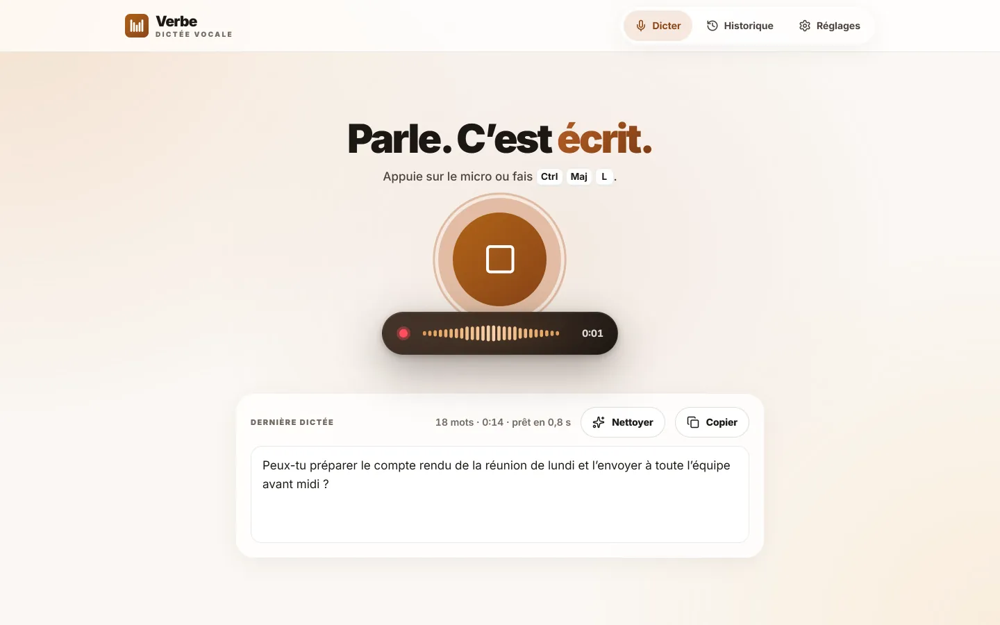

# Verbe : dictée vocale

[](https://github.com/landry160/verbe/actions/workflows/tests.yml)

Parle, c'est écrit, puis collé là où tu écris.


- **Essayer dans le navigateur :** https://landry160.github.io/verbe/
- **Télécharger pour Windows :** [Verbe-Setup.exe](https://github.com/landry160/verbe/releases/latest/download/Verbe-Setup.exe)
  (installateur pas encore signé : si Windows avertit, « Informations complémentaires » puis « Exécuter quand même »)



Voir aussi `VISION.md` : ce que Verbe veut être, et ce qui ne doit pas changer.

## Deux façons de l'utiliser

| | Version web | Version bureau (Windows) |
|---|---|---|
| Ouvrir | https://landry160.github.io/verbe/ dans Chrome ou Edge (ou `app/verbe.html`) | **Verbe** sur le Bureau ou dans le menu Démarrer |
| Ctrl + Maj + L | seulement quand Verbe est la fenêtre active | **dans toutes les apps** (Word, Teams, Claude…) |
| Indicateur | pastille dans la page, ou mini-fenêtre de Chrome | **bulle** sans cadre, micro rond au centre (en bas par défaut) |
| Après la dictée | texte copié, tu fais Ctrl + V | texte **collé tout seul** là où tu écrivais |
| « Ce qu'il te reste » | estimé par Verbe (24 h) | chiffres de Groq (requêtes) + audio compté par Verbe |

Les deux versions partagent la même page (`app/verbe.html`), construite par Vite à partir de `src/`.
La version bureau ajoute seulement `bureau/` : la fenêtre, la bulle, le raccourci global, le collage
et la lecture des compteurs de limite.

## Sur le téléphone (version web installée)

La version web s'installe comme une app : une icône sur l'écran d'accueil, Verbe en plein écran,
et il s'ouvre même sans réseau (la transcription, elle, a besoin d'Internet).

- **Android (Chrome)** : ouvrir https://landry160.github.io/verbe/, puis Réglages › Général › **Installer**
  (ou le menu ⋮ › « Installer l'application »).
- **iPhone (Safari)** : ouvrir la même adresse, touche **Partager**, puis **« Sur l'écran d'accueil »**.
  Réglages › Général le rappelle.

La clé Groq se colle une fois dans l'app installée (elle a son propre stockage). L'écoute s'arrête si l'écran
se verrouille : pour une longue réunion, enregistrer avec le dictaphone du téléphone, puis « Importer un fichier ».

Les fichiers de l'app installable sont dans `public/` (`manifest.webmanifest`, `sw.js`, `icons/`), copiés dans `app/`
par Vite. Le service hors connexion (`sw.js`) prend toujours le réseau d'abord et ne touche jamais aux appels vers
Groq ou OpenAI. L'app Windows n'en a pas besoin : ni service, ni bouton « Installer ».

## Utiliser la version bureau

1. Double-clique **Verbe** sur le Bureau. L'icône cuivre apparaît près de l'horloge.
2. La première fois, colle ta clé Groq dans **Réglages › Transcription**.
3. Dans n'importe quelle app : **Ctrl + Maj + L**, parle, **Ctrl + Maj + L**. Le texte arrive là où était ton curseur.
4. **Échap** annule pendant l'écoute. Fermer la fenêtre range Verbe près de l'horloge ; « Quitter Verbe » dans son menu l'arrête.
   Pendant l'écoute, ce menu propose aussi **Terminer la dictée** et **Annuler la dictée** : une sortie
   qui ne dépend pas de la bulle. La bulle ne surveille pas la souris de Windows (depuis la 0.6.4) :
   l'app regarde où est le curseur et ne prend les clics que sur la pastille. Une bulle plantée est refaite
   à neuf (micro libéré, Échap rendu à Windows).
5. **Mises à jour** : quelques secondes après son démarrage, puis toutes les 6 h, Verbe regarde s'il y a une nouvelle version,
   la télécharge en arrière-plan et l'installe quand tu le quittes. « Redémarrer maintenant » (Réglages › Général, ou le menu
   de l'icône près de l'horloge) l'installe tout de suite. L'interrupteur « Mises à jour automatiques » (actif par défaut) et
   le bouton « Vérifier maintenant » sont dans Réglages › Général. La version web, elle, est toujours à jour.

### Le texte est parti au mauvais endroit ?

Après chaque dictée, le texte **reste dans le presse-papiers** : clique au bon endroit et fais **Ctrl + V**.
La bulle le rappelle (« Collé · Ctrl + V pour le recoller ailleurs »). Pour retrouver plutôt ce que tu avais
copié avant, coupe « Garder la dictée dans le presse-papiers » (Réglages › Texte) : il revient une seconde
après le collage, et **Ctrl + Maj + 9** recolle la dernière dictée.

### Deux raccourcis de plus (Réglages › Raccourci)

- **Recoller la dernière dictée** (**Ctrl + Maj + 9**, allumé par défaut) : le texte est parti dans la mauvaise
  fenêtre ? Clique au bon endroit et fais le raccourci : la dernière dictée y est collée, même si tu as copié autre chose depuis.
- **Réécrire la sélection** (proposé : **Ctrl + Maj + 7**) : sélectionne un texte dans n'importe quelle app,
  fais le raccourci, dis la consigne (« plus poli », « plus court », « en anglais », « corrige les fautes »),
  puis refais le raccourci (ou Ctrl + Maj + L, ou tais-toi : l'arrêt automatique). Verbe remplace la
  sélection par la version réécrite. Il utilise la clé déjà donnée (même modèle que le texte propre) ;
  le texte sélectionné n'est jamais pris pour une consigne.
- Réécrire est **éteint par défaut** (Recoller est allumé, sur une combinaison sans conflit) : un raccourci global vole sa combinaison dans toutes les apps, et
  aucune lettre n'est libre avec Ctrl + Maj (Word, Teams, VS Code ou Edge en prennent chacune). Les chiffres
  7 et 9 ne sont pris que par Excel ; 8 affiche les ¶ dans Word. Pas de Ctrl + Alt : c'est AltGr sur un clavier canadien.
- « Modifier » les change comme le raccourci principal. Une combinaison déjà prise par un autre raccourci
  de Verbe est refusée ; une combinaison déjà prise par une autre app est signalée.
- Après une réécriture, ce que tu avais copié revient dans le presse-papiers (ou tout de suite si tu annules).
  Ces raccourcis n'existent pas dans la version web (le bouton Copier suffit).

## Réglages

Une section à la fois : Transcription (service, clé, langue, **ce qu'il te reste**), Micro, Raccourci (dictée ; dans le bureau, Recoller et Réécrire),
Texte (commandes à la voix, texte propre, « Coller en » une autre langue, ton selon l'app, collage, mes mots, textes tout prêts), Bulle (forme Barres / Onde / Points dessinée
en ligne de part et d’autre du micro, position en bas par défaut, sons, aperçu) et Général (apparence, lancement avec Windows, mises à jour automatiques, audio gardé, historique).

## Commandes à la voix

« virgule », « point final », « point à la ligne », « nouvelle ligne », « nouveau paragraphe »,
« point d'interrogation », « point d'exclamation », « point-virgule »,
« ouvrez les guillemets » / « fermez les guillemets », « efface ça » (retire la phrase d'avant).

## Tes progrès (en haut de l'Historique)

Une ligne discrète : les mots dictés cette semaine (à partir du lundi) et au total, le temps gagné estimé
et, à partir de 3 jours, la série de jours de suite. Rien ne s'affiche avant la première dictée réussie.
- Temps gagné = les mots tapés au clavier à **40 mots par minute**, moins le temps réellement passé à parler.
  Un clic (ou un toucher) sur la ligne montre ce calcul.
- Seule une dictée au micro réussie compte, une seule fois : ni un échec, ni « Nettoyer », ni « Retranscrire »,
  ni un fichier transcrit.
- Le compteur est gardé à part (`verbe.stats` dans le stockage local), car l'historique ne garde que 100 dictées ;
  « Vider l'historique » ne le remet pas à zéro. La première fois, il part des dictées déjà dans l'historique.
- Bureau : la bulle compte la dictée, la fenêtre principale se met à jour aussitôt.
## Mes mots et textes tout prêts

Dans **Réglages › Texte**, deux listes : ajouter, modifier, retirer (une ligne vide est ignorée).

- **Mes mots** : noms propres et jargon (SlideFabrik, Groq, Granby…). Ils partent à Whisper comme indice
  (champ `prompt`, Groq et OpenAI seulement ; limité à environ 224 jetons, les premiers mots de la liste d'abord).
  « Ce qu'il entend » (ex. « slide fabrique ») est remplacé par le mot, sans tenir compte des majuscules
  et sur des mots entiers seulement (« slide fabriques » ne bouge pas). Plusieurs façons : sépare-les par des virgules.
- **Textes tout prêts** : un nom court donne un texte (signature, courriel, formule de politesse, sur plusieurs lignes au besoin).
  Il se déclenche seulement si la dictée n'est **que** son nom (« Signature. », « Insère ma signature. »),
  ou par une phrase à part qui commence par « insère » (« Merci. Insère ma signature. »).
  Un nom dit au milieu d'une phrase (« je mets ma signature en bas ») n'est jamais remplacé.
- Ordre après la transcription : mes mots → texte tout prêt seul (rendu tel quel) → commandes à la voix
  → texte propre (il ne voit jamais un texte tout prêt) → insertion des « Insère … ».
## Traduire en dictant, ton selon l'app

- **Coller en** (Réglages › Texte) : « Comme je parle » par défaut, ou Français, English, Español.
  Tu parles dans ta langue, Verbe copie (et colle, dans le bureau) la traduction ; ce que tu as dit
  reste dans l'historique (au survol de la langue). Avec le texte propre automatique, un seul appel au modèle fait les deux.
- **Adapter le ton à l'app** (bureau seulement, Réglages › Texte, coupé par défaut) : au début de la dictée,
  Verbe lit le nom de l'app où tu écris. Courriel et documents (Outlook, nouvel Outlook, Word, Thunderbird…) :
  ton soigné. Messagerie (Teams, Slack, Discord, WhatsApp…) : ton détendu. Code et terminal (VS Code, Cursor,
  Visual Studio, JetBrains, Windows Terminal, PowerShell…) : texte tel quel, sans appel au modèle. Ailleurs : rien de spécial.
  Seul le registre change, jamais ce qui est dit. Coupé par défaut, car chaque dictée passe alors par le modèle (environ 1 s et une requête de plus).
- Les deux passent par le modèle de langue de « Nettoyer », avec ta clé. Sans clé (ou en mode Navigateur sans clé),
  le texte d'origine est collé et Verbe prévient une fois.

## Ce qu'il te reste (limites du service)

Groq, forfait gratuit, Whisper (vérifié le 23 nov. 2026 sur console.groq.com/docs/rate-limits) :
2 000 requêtes par jour, 8 h d'audio par jour, 2 h d'audio par heure. Groq compte au moins 10 s par requête.
Ces limites glissent : rien ne se remet à zéro à minuit, chaque envoi revient 24 h après. Depuis la 0.6.3,
Verbe dit donc ce qui a été utilisé sur les dernières 24 h et quand le prochain morceau de temps revient.
Groq renvoie les requêtes restantes dans chaque réponse, mais un navigateur ne peut pas les lire :
l'app bureau les rend lisibles. Sinon, Verbe compte ce que l'appareil a envoyé sur 24 h.
OpenAI et Mistral sont payés à l'usage : Verbe affiche l'audio envoyé et son coût estimé.

**Silences coupés avant l'envoi** (rien à régler) : le silence du début et de la fin d'une dictée au micro
ne part pas (Verbe garde 0,4 s avant la voix et 0,5 s après), et une pause de plus de 2 s est ramenée à 0,7 s.
Moins de temps compté, une réponse plus rapide, et pas de phrase inventée sur le vide. Une dictée sans silence
notable (moins de 2 s à gagner) part telle quelle ; sinon, l'audio coupé part en WAV (environ 1,9 Mo par minute
de voix, en morceaux de 5 min au plus). Le compteur compte l'audio envoyé. L'historique garde l'enregistrement
d'origine, et « Retranscrire » coupe ses silences à nouveau. Les fichiers importés partent tels quels.

## Développement

Le code est rangé en fichiers ; **Vite** les rassemble en une seule page, `app/verbe.html`
(c'est elle que chargent l'app bureau, GitHub Pages et les tests).

```
src/verbe.html     le HTML de la page
src/styles/        le CSS, une zone par fichier (jetons, Dicter, réglages, bulle…)
src/app/           l'app, 00-outils.js … 12-demarrage.js : rassemblés dans l'ordre en un seul module
src/lib/           la logique autonome en TypeScript (audio, texte, apps, versions), testée avec Vitest
public/            polices et licences, copiées à côté de la page
bureau/            l'app Electron (fenêtre, bulle, raccourcis, collage, mises à jour)
```

```
npm install            # installe Electron, electron-builder, Vite, TypeScript, Vitest et Playwright
npm run dev            # la page dans le navigateur (http://localhost:5173/verbe.html), rechargée à chaque modification
npm run dev:bureau     # l'app bureau branchée sur Vite (profil à part), rechargée à chaque modification
npm run build          # construit app/verbe.html (à enregistrer avec le reste : la CI vérifie qu'elle est à jour)
npm start              # construit puis lance la version bureau
npm run raccourci      # recrée les raccourcis Bureau et menu Démarrer (version de développement)
npm run installateur   # construit la page puis dist\Verbe-Setup.exe, dist\latest.yml et dist\Verbe-Setup.exe.blockmap
```

- Les fichiers de `src/app/` partagent une seule portée (comme l'ancien script unique) : l'ordre des numéros compte.
  Une logique qui ne dépend ni de la page ni des réglages va plutôt dans `src/lib/`, en TypeScript, avec ses tests.

- Tester sans toucher les vrais réglages : `electron . --profil=<dossier>` (profil à part).
- Mises à jour : la version de développement ne vérifie jamais (`app.isPackaged` faux). Pour essayer quand même :
  `electron . --profil=<dossier> --maj-test=http://127.0.0.1:<port>/`, avec un serveur local qui sert un `latest.yml`
  (fournisseur « generic »). En mode test, le téléchargement reste dans le profil et rien ne s'installe.
- Si `npm run installateur` échoue sur « Cannot create symbolic link » (outil winCodeSign) :
  décompresser l'archive du cache `%LOCALAPPDATA%\electron-builder\Cache\winCodeSign\*.7z` dans
  `winCodeSign-2.6.0` avec `node_modules\7zip-bin\win\x64\7za.exe x … -o…` (les 2 erreurs sur des fichiers Mac sont sans effet), puis relancer.
- L'installateur n'est pas signé : Windows affiche « Windows a protégé votre ordinateur » → « Informations complémentaires » → « Exécuter quand même ».

## Tests

```
npx playwright install chromium   # une fois : le navigateur des tests
npm test                          # tout : types, tests rapides, puis Chromium et Electron (bureau : Windows seulement)
npm run test:unit                 # tests rapides (Vitest) de src/lib, environ 1 s
npm run typecheck                 # TypeScript strict sur src/lib
npm run test:web                  # la page servie comme sur GitHub Pages, dans Chromium
npm run test:bureau               # l'app Electron (Windows)
```

- **Rapides** (`tests/unit`, Vitest) : commandes à la voix, nettoyage de la transcription, détection de voix,
  silences coupés, découpe des longs audios, WAV, catégories d'apps, versions.

- **Web** (`tests/web`) : dictée au raccourci et au micro flottant, Échap, commandes à la voix,
  « Nettoyer », mes mots et textes tout prêts, « Coller en » (traduction), Réglages (ordinateur et téléphone), « Ce qu'il te reste », progrès de l'Historique,
  mise en page sans défilement, silences coupés avant l'envoi, app installable (fiche et icônes, ouverture sans réseau,
  bouton « Installer », marche à suivre sur iPhone, Nouveautés propres au web).
- **Bureau** (`tests/bureau`) : position et formes de la bulle, réparation des réglages, collage par SendInput,
  presse-papiers rendu après le collage, progrès à jour dans la fenêtre principale après une dictée de la bulle,
  ton selon l'app (catégorie des programmes, consigne envoyée au modèle simulé), mises à jour (nouvelle version,
  à jour, interrupteur coupé, version de développement) avec un serveur local et un faux installateur, jamais lancé.
  `raccourcis.spec.js` : Recoller, Réécrire (sélection, consigne,
  collage, presse-papiers rendu, rien de sélectionné, Échap, sans clé), doublons refusés, raccourci pris par une autre app.
  `bulle-souris.spec.js` : aucun crochet sur la souris, clics pris seulement sur la pastille (curseur simulé),
  « Terminer » et « Annuler » dans le menu de l'icône pendant l'écoute, bulle plantée refaite (Échap rendu).
  Il lance l'app avec `--essai-clavier` : touches, presse-papiers et raccourcis globaux sont des faux en mémoire,
  le micro est le faux micro de Chromium et Groq est simulé dans l'app (`protocol.handle`).
- Groq est simulé : aucun appel réel, et une requête inattendue vers Internet fait échouer le test.
  Le micro est un faux micro de Chromium qui joue des « syllabes » (un son continu serait effacé par l’anti-bruit).
- Rien de personnel n'est touché : la version bureau tourne dans un profil à part (`--profil=`),
  aucune dictée ni aucun collage réel n'a lieu, et le presse-papiers est remis tel quel à la fin.
- Sur GitHub, chaque envoi sur `main` lance les deux séries (`.github/workflows/tests.yml`) :
  la version web sous Linux, la version bureau sous Windows.

## Publier une version

1. Monter la version dans `package.json` et dans `VERSION` (`app/verbe.html`, un test vérifie qu'elles sont pareilles),
   puis ajouter ses nouveautés en tête de `NOUVEAUTES` (icône, titre, une phrase ; `desk: true` si elle ne concerne
   que Windows, `web: true` si elle ne concerne que la version web). Après la mise à jour, Verbe les présente une fois
   dans la fenêtre des Nouveautés ; Réglages › Général › « Nouveautés » la rouvre.
   **Une version qui ne change que le web** (comme la 0.6.2) : pousser sur `main` suffit (GitHub Pages) ; sans étiquette,
   l'app Windows ne télécharge pas une mise à jour qui ne lui apporte rien.
2. **Automatique** : créer puis pousser l'étiquette `v<version>` (par exemple `v0.4.7`).
   `.github/workflows/release.yml` construit alors l'installateur sous Windows et publie la version GitHub avec les trois fichiers.
3. **À la main**, si besoin : `npm run installateur`, puis créer une version (« Release ») sur GitHub avec l'étiquette
   `v<version>` et y joindre les **trois** fichiers de `dist`, sans les renommer :
   - **`Verbe-Setup.exe`** : l'installateur ;
   - **`latest.yml`** : la version, le nom et l'empreinte (sha512) de l'installateur ; c'est ce que lisent les mises à jour automatiques ;
   - **`Verbe-Setup.exe.blockmap`** : permet de ne télécharger que ce qui a changé.

   L'installateur s'appelle déjà `Verbe-Setup.exe` (`artifactName` dans `package.json`) : ne plus le renommer,
   sinon `latest.yml` nommerait un fichier absent. Le lien `https://github.com/landry160/verbe/releases/latest/download/Verbe-Setup.exe`
   mène toujours à la dernière version.
4. Ce lien est dans `DOWNLOAD_URL` (`app/verbe.html`) : le bouton « Télécharger pour Windows » apparaît dans la version web (Réglages › Raccourci), seulement sur un ordinateur Windows.
5. Les versions installées qui ont les mises à jour automatiques trouvent la nouvelle version seules : electron-updater lit
   la dernière version GitHub publiée (pas les brouillons ni les préversions). Les versions plus anciennes (0.4.6 et avant)
   se mettent à jour une dernière fois à la main.

**Signature.** L'app n'est pas signée. electron-updater ne vérifie la signature du nouvel installateur que si
`app-update.yml` (écrit dans l'app par electron-builder) contient un `publisherName`, ce qui n'arrive qu'avec un certificat.
Sans signature, la mise à jour est donc acceptée ; seule l'empreinte sha512 donnée par `latest.yml` est vérifiée.
Le jour où l'app sera signée, chaque version suivante devra l'être avec le même certificat, sinon elle sera refusée.

## Licences

- Code de Verbe : licence **MIT** (`LICENSE`). Tu peux le réutiliser, le modifier et le redistribuer,
  en gardant la mention de l'auteur.
- Police **Inter** : SIL Open Font License 1.1 (`app/fonts/OFL.txt`).
- Icônes : **Lucide** (licence ISC, `app/LICENCE-lucide.txt`), intégrées dans `app/verbe.html`.
