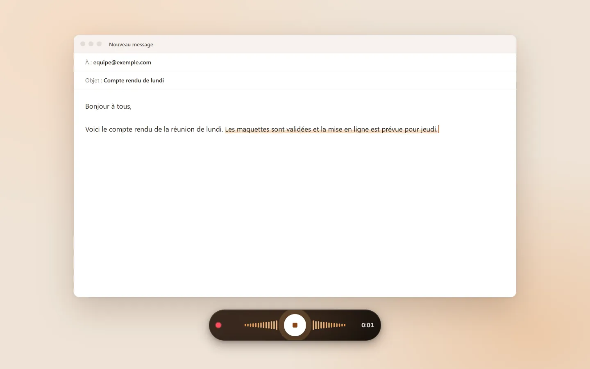

# Verbe : dictée vocale

[](https://github.com/landry160/verbe/actions/workflows/tests.yml)

Parle, c'est écrit, puis collé là où tu écris.



- **Essayer dans le navigateur :** https://landry160.github.io/verbe/
- **Télécharger pour Windows :** [Verbe-Setup.exe](https://github.com/landry160/verbe/releases/latest/download/Verbe-Setup.exe)
  (installateur pas encore signé : si Windows avertit, « Informations complémentaires » puis « Exécuter quand même »)


Voir aussi `VISION.md` : ce que Verbe veut être, et ce qui ne doit pas changer.

## Deux façons de l'utiliser

| | Version web | Version bureau (Windows) |
|---|---|---|
| Ouvrir | https://landry160.github.io/verbe/ dans Chrome ou Edge (ou `app/verbe.html`) | **Verbe** sur le Bureau ou dans le menu Démarrer |
| Ctrl + Maj + L | seulement quand Verbe est la fenêtre active | **dans toutes les apps** (Word, Teams, Claude…) |
| Indicateur | pastille dans la page, ou mini-fenêtre de Chrome | **bulle** sans cadre, micro rond au centre (en bas par défaut) |
| Après la dictée | texte copié, tu fais Ctrl + V | texte **collé tout seul** là où tu écrivais |
| « Ce qu'il te reste » | estimé par Verbe (24 h) | chiffres de Groq (requêtes) + audio compté par Verbe |

Les deux versions partagent la même page (`app/verbe.html`). La version bureau ajoute
seulement `bureau/` : la fenêtre, la bulle, le raccourci global, le collage et la lecture
des compteurs de limite.

## Utiliser la version bureau

1. Double-clique **Verbe** sur le Bureau. L'icône cuivre apparaît près de l'horloge.
2. La première fois, colle ta clé Groq dans **Réglages › Transcription**.
3. Dans n'importe quelle app : **Ctrl + Maj + L**, parle, **Ctrl + Maj + L**. Le texte arrive là où était ton curseur.
4. **Échap** annule pendant l'écoute. Fermer la fenêtre range Verbe près de l'horloge ; « Quitter Verbe » dans son menu l'arrête.

## Réglages

Une section à la fois : Transcription (service, clé, langue, **ce qu'il te reste**), Micro, Raccourci,
Texte (commandes à la voix, texte propre, collage), Bulle (forme Barres / Onde / Points dessinée
en ligne de part et d’autre du micro, position en bas par défaut, sons, aperçu) et Général (apparence, lancement avec Windows, audio gardé, historique).

## Commandes à la voix

« virgule », « point final », « point à la ligne », « nouvelle ligne », « nouveau paragraphe »,
« point d'interrogation », « point d'exclamation », « point-virgule »,
« ouvrez les guillemets » / « fermez les guillemets », « efface ça » (retire la phrase d'avant).

## Ce qu'il te reste (limites du service)

Groq, forfait gratuit, Whisper (vérifié le 23 nov. 2026 sur console.groq.com/docs/rate-limits) :
2 000 requêtes par jour, 8 h d'audio par jour, 2 h d'audio par heure. Groq compte au moins 10 s par requête.
Groq renvoie les requêtes restantes dans chaque réponse, mais un navigateur ne peut pas les lire :
l'app bureau les rend lisibles. Sinon, Verbe compte ce que l'appareil a envoyé sur 24 h.
OpenAI et Mistral sont payés à l'usage : Verbe affiche l'audio envoyé et son coût estimé.

## Développement

```
npm install            # installe Electron et electron-builder
npm start              # lance la version bureau (sans ELECTRON_RUN_AS_NODE dans l'environnement)
npm run raccourci      # recrée les raccourcis Bureau et menu Démarrer (version de développement)
npm run installateur   # construit dist\Verbe-Setup-<version>.exe
```

- Tester sans toucher les vrais réglages : `electron . --profil=<dossier>` (profil à part).
- Si `npm run installateur` échoue sur « Cannot create symbolic link » (outil winCodeSign) :
  décompresser l'archive du cache `%LOCALAPPDATA%\electron-builder\Cache\winCodeSign\*.7z` dans
  `winCodeSign-2.6.0` avec `node_modules\7zip-bin\win\x64\7za.exe x … -o…` (les 2 erreurs sur des fichiers Mac sont sans effet), puis relancer.
- L'installateur n'est pas signé : Windows affiche « Windows a protégé votre ordinateur » → « Informations complémentaires » → « Exécuter quand même ».

## Tests

```
npx playwright install chromium   # une fois : le navigateur des tests
npm test                          # tout (la partie bureau seulement sous Windows)
npm run test:web                  # la page servie comme sur GitHub Pages, dans Chromium
npm run test:bureau               # l'app Electron (Windows)
```

- **Web** (`tests/web`) : dictée au raccourci et au micro flottant, Échap, commandes à la voix,
  « Nettoyer », Réglages (ordinateur et téléphone), « Ce qu'il te reste », mise en page sans défilement.
- **Bureau** (`tests/bureau`) : position et formes de la bulle, réparation des réglages, collage par SendInput,
  presse-papiers rendu après le collage.
- Groq est simulé : aucun appel réel, et une requête inattendue vers Internet fait échouer le test.
  Le micro est un faux micro de Chromium qui joue un son continu.
- Rien de personnel n'est touché : la version bureau tourne dans un profil à part (`--profil=`),
  aucune dictée ni aucun collage réel n'a lieu, et le presse-papiers est remis tel quel à la fin.
- Sur GitHub, chaque envoi sur `main` lance les deux séries (`.github/workflows/tests.yml`) :
  la version web sous Linux, la version bureau sous Windows.

## Publier une version

1. Monter la version dans `package.json` (et le pied de Réglages › Général), puis `npm run installateur`.
2. Créer une version (« Release ») sur GitHub et y joindre l'installateur sous le nom **`Verbe-Setup.exe`** :
   le lien `https://github.com/landry160/verbe/releases/latest/download/Verbe-Setup.exe` mène alors toujours à la dernière version.
3. Ce lien est dans `DOWNLOAD_URL` (`app/verbe.html`) : le bouton « Télécharger pour Windows » apparaît dans la version web (Réglages › Raccourci), seulement sur un ordinateur Windows.
4. Plus tard : mises à jour automatiques (electron-updater) et signature du code.

## Licences

- Code de Verbe : licence **MIT** (`LICENSE`). Tu peux le réutiliser, le modifier et le redistribuer,
  en gardant la mention de l'auteur.
- Police **Inter** : SIL Open Font License 1.1 (`app/fonts/OFL.txt`).
- Icônes : **Lucide** (licence ISC, `app/LICENCE-lucide.txt`), intégrées dans `app/verbe.html`.
